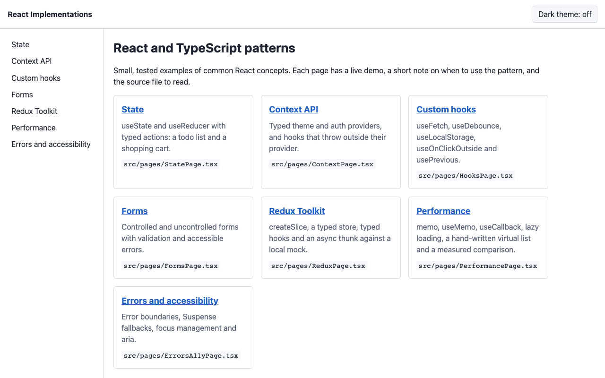
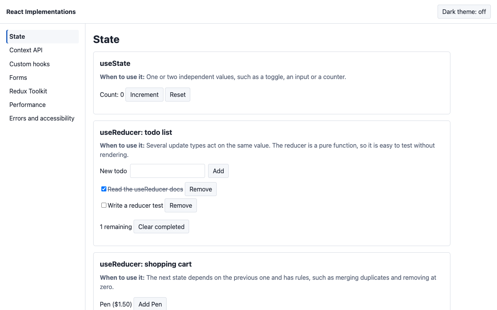
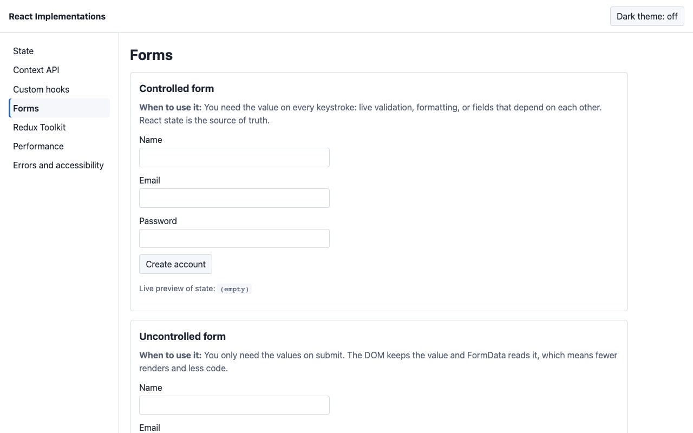
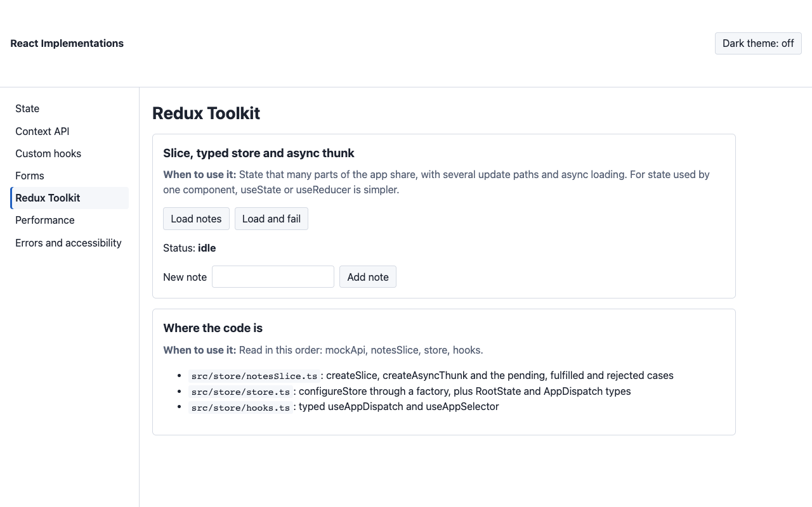
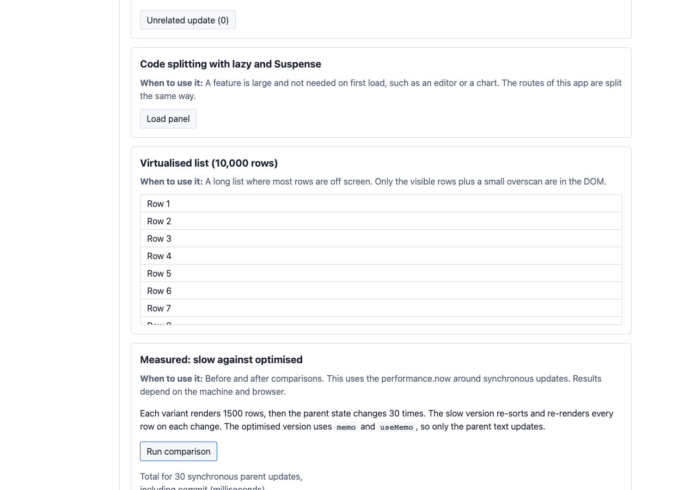
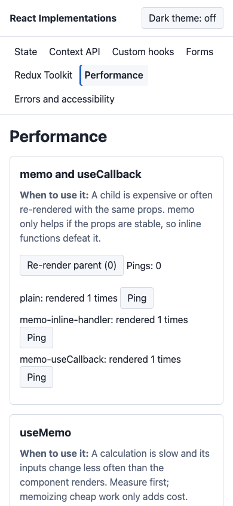

# React Implementations

A small React and TypeScript app where each common React concept has its own page with a live demo, a short note on when to use it, and tests. It started as a place for React trial code and is now organised as a set of focused patterns.

Stack: React 18, TypeScript (strict), Vite, React Router 6 (hash routing), Redux Toolkit, Jest, React Testing Library, ESLint, GitHub Actions.



## Concept index

| Page | Route | What it shows | Source |
| --- | --- | --- | --- |
| State | `#/state` | `useState`, `useReducer` with typed actions (todo list, shopping cart) | [StatePage](src/pages/StatePage.tsx), [todoReducer](src/state/todoReducer.ts), [cartReducer](src/state/cartReducer.ts) |
| Context API | `#/context` | Typed theme and auth providers, hooks that throw outside the provider | [ContextPage](src/pages/ContextPage.tsx), [ThemeContext](src/context/ThemeContext.tsx), [AuthContext](src/context/AuthContext.tsx) |
| Custom hooks | `#/hooks` | `useFetch` (loading, error, abort), `useDebounce`, `useLocalStorage`, `useOnClickOutside`, `usePrevious` | [HooksPage](src/pages/HooksPage.tsx), [src/hooks](src/hooks) |
| Forms | `#/forms` | Controlled and uncontrolled forms, validation messages, aria-invalid and aria-describedby, focus on first error | [FormsPage](src/pages/FormsPage.tsx), [validate](src/forms/validate.ts) |
| Redux Toolkit | `#/redux` | `createSlice`, typed store and hooks, `createAsyncThunk` against a local mock | [ReduxPage](src/pages/ReduxPage.tsx), [src/store](src/store) |
| Performance | `#/performance` | `memo`, `useMemo`, `useCallback`, `lazy` and `Suspense`, a hand-written virtual list, a measured comparison | [PerformancePage](src/pages/PerformancePage.tsx), [src/perf](src/perf) |
| Errors and accessibility | `#/errors-a11y` | Error boundary, Suspense fallback, dialog focus management, live region | [ErrorsA11yPage](src/pages/ErrorsA11yPage.tsx), [ErrorBoundary](src/components/ErrorBoundary.tsx) |

Every route is also loaded as its own chunk with `React.lazy` (see [App.tsx](src/App.tsx)). The layout is responsive and has a skip link and a light and dark theme toggle.

| State | Forms |
| --- | --- |
|  |  |

| Redux | Performance (measured) | Mobile, 390px |
| --- | --- | --- |
|  |  |  |

## Setup

Requires Node 20.

```
npm ci
npm run dev        # http://localhost:5400
```

## Scripts

| Script | Does |
| --- | --- |
| `npm run dev` | Vite dev server on port 5400 |
| `npm run build` | `tsc --noEmit` then `vite build` into `dist/` |
| `npm run preview` | Serves `dist/` on port 5400 |
| `npm run lint` | ESLint (typescript-eslint, react-hooks) |
| `npm run typecheck` | `tsc --noEmit` |
| `npm test` | Jest |
| `npm run test:coverage` | Jest with coverage |
| `npm run bench` | Reads the slow against optimised numbers from a running preview |

## Tests

Jest with ts-jest and jsdom, React Testing Library, user-event and jest-dom. Tests live in [tests](tests):

- `reducers.test.ts`, `validate.test.ts`: pure unit tests (todo and cart reducers, form validation)
- `hooks.test.tsx`: `renderHook` tests for every custom hook, including debounce with fake timers and `useFetch` abort on URL change and unmount
- `context.test.tsx`: providers, and the error thrown when a hook is used outside its provider
- `store.test.ts`, `redux-page.test.tsx`: slice reducers, thunk pending, fulfilled and rejected states, end-to-end thunk dispatch, and the Redux page
- `perf.test.tsx`: window calculation, virtual list rendering and scrolling, benchmark component, memo and useMemo behaviour
- `pages.test.tsx`: State, Hooks, Forms and Errors pages, error boundary, routing for every page, the not found page, theme toggle

Last run on 2026-11-01: 8 suites, 80 tests, all passing. Coverage: statements 98.33%, branches 88.07%, functions 97.34%, lines 99%.

Browser checks (`scripts/verify.mjs`, Playwright with system Chrome against `vite preview` on port 5400): all 9 routes (including an unknown one) at 1280px and 390px render an h1, log no console errors, and have no horizontal scroll (18 of 18 checks passed). This script is not part of CI.

## Measured performance

The Performance page has a "Run comparison" button. It renders 1500 rows, then changes unrelated parent state 30 times with `flushSync`, and reports total time from `performance.now`. The slow version re-sorts and re-renders every row on each update. The optimised version uses `memo` and `useMemo`, so only the parent text changes.

Result (median of 7 fresh page loads, production build):

| Version | Time for 30 updates |
| --- | --- |
| slow | 32.2 ms |
| optimised | 0.5 ms |

- Date: 2026-11-01
- Machine: Apple M5, 10 cores, 16 GB, macOS, Chrome 150.0.7871.47 headless
- Raw samples (ms), slow: 33, 34.5, 32.2, 34.2, 28.9, 30.2, 24.4; optimised: 0.6, 0.5, 0.6, 0.6, 0.5, 0.5, 0.4

Reproduce:

```
npm run build
npm run preview     # in one terminal
npm run bench       # in another; needs Chrome installed, RUNS=7 by default
```

Numbers will differ on other machines. The React Profiler does not report in production builds, so `performance.now` is used. The test measures the render and commit of a contrived list, not a real application.

## CI

- [.github/workflows/ci.yml](.github/workflows/ci.yml): Node 20, `npm ci`, lint, typecheck, tests with coverage, build.
- [.github/workflows/pages.yml](.github/workflows/pages.yml): manual deploy of `dist/` to GitHub Pages.

Both files were checked with actionlint (`pip install actionlint-py` in a local `.venv`). They were not run on GitHub from here. The Pages workflow needs Pages set to "GitHub Actions" in the repository settings. Vite uses `base: './'` and the router uses the URL hash, so the build works under `/<repo>/` on Pages and in local dev without any server rewrite rules.

## Structure

```
src/
  App.tsx, main.tsx, styles.css
  components/   Layout, Demo, ErrorBoundary
  context/      ThemeContext, AuthContext
  forms/        validate.ts
  hooks/        useFetch, useDebounce, useLocalStorage, useOnClickOutside, usePrevious
  pages/        one file per demo page, plus registry.ts and HomePage
  perf/         VirtualList, Benchmark, MemoDemo, HeavyPanel
  state/        todoReducer, cartReducer
  store/        notesSlice, store, hooks, mockApi
tests/          Jest test files
scripts/        measure.mjs (benchmark reader), verify.mjs (route and screenshot check)
public/data/    products.json used by the useFetch demo
docs/           screenshots
```

## Limitations

- Hash routing (`#/state`) is used instead of clean URLs to keep GitHub Pages simple.
- The Redux demo creates its own store inside the page. A real app would create one at the root.
- The auth context only keeps a name in memory. There is no server and no persistence.
- The virtual list assumes fixed row height and has no keyboard row navigation.
- The benchmark is a contrived case and the numbers are from one machine.
- The scripts in `scripts/` need Chrome installed locally (`playwright-core` uses the system browser).
- Branch coverage is lower than line coverage; some defensive branches in the hooks and slices are not tested.
